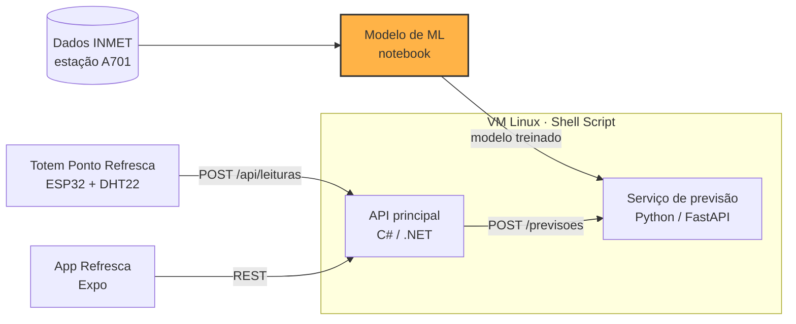

# Refresca · Modelo de previsão de calor perigoso

> Parte da CitizenTech **Refresca**, da Global Solution 2026.2 (FIAP, Engenharia de Software, 3º ano de Fev).
> Alertas de calor extremo e pontos de água e sombra para trabalhadores de rua da Vila Mariana.

**Disciplina:** Inteligência Artificial & Machine Learning

## Ficha da CitizenTech

| Campo | Conteúdo |
| --- | --- |
| **Nome** | Refresca |
| **Cidade e bairro** | São Paulo, Vila Mariana |
| **Cidadão beneficiado** | Trabalhador de rua: ambulante, entregador, gari, vendedor de banca |
| **Problema, em uma frase** | Trabalhadores de rua da Vila Mariana passam o dia expostos ao sol sem saber quando o calor fica perigoso, nem onde encontrar sombra e água por perto. |
| **Como funciona** | 1. Totens "Ponto Refresca" em comércios parceiros medem o índice de calor na rua e mostram um alerta colorido para quem passa. 2. Um modelo treinado com dados do INMET prevê se amanhã será um dia de calor perigoso. 3. O app avisa o trabalhador na véspera, mostra os pontos com água, sombra e banheiro mais próximos e lembra das pausas para hidratação. |
| **O que cada parte faz** | Ver [Repositórios da Refresca](#repositórios-da-refresca) |
| **Link do repositório** | https://github.com/danilowendler/GS-IA-ML |
| **Indicador de impacto** | Pausas de hidratação registradas no app em dias de alerta; % de alertas enviados antes do pico de calor; recall do modelo nos dias perigosos |
| **ODS conectados** | 3, 8, 10, 11 e 13 (detalhes abaixo) |

### Persona (fictícia)

Persona criada pela equipe a partir de informações públicas sobre trabalho de rua e calor. Não representa uma pessoa real nem uma entrevista realizada.

**Marcos, 34 anos, entregador de moto por aplicativo na Vila Mariana.** Passa cerca de 10 horas por dia na rua, esperando pedidos na calçada. Nos dias mais quentes sente dor de cabeça e tontura no fim da tarde. Compra água no comércio ou fica sem, quase não para porque perde corridas e tem pouco dado no celular pré-pago.

### Como os ODS são atendidos

- **ODS 3 · Saúde e bem-estar:** reduz o risco de exaustão e insolação ao antecipar dias perigosos e incentivar pausas e hidratação.
- **ODS 8 · Trabalho decente:** melhora as condições de trabalho de quem não tem posto fixo nem empregador que ofereça estrutura.
- **ODS 10 · Redução das desigualdades:** chega a quem tem pouco acesso a dados móveis, já que o totem funciona sem celular.
- **ODS 11 · Cidades sustentáveis:** transforma comércios do bairro em uma rede de pontos de apoio no espaço público.
- **ODS 13 · Ação contra a mudança do clima:** é uma ferramenta de adaptação a ondas de calor.

## Esta parte da Refresca

O modelo de Machine Learning responde à pergunta: **com o clima de hoje, amanhã será um dia de calor perigoso em São Paulo?** Com essa previsão, a Refresca avisa o trabalhador de rua na véspera, para que ele leve água e planeje pausas na sombra.

O modelo é um classificador XGBoost treinado com dados horários reais do INMET (estação A701, 2019 a 2025). Um dia é "perigoso" quando o índice de calor máximo chega a 32 °C, o mesmo limite do nível "perigo" do totem e do app.

### Resultado no teste (2024 e 2025, dias nunca vistos no treino)

| | Modelo Refresca | Regra "amanhã = hoje" |
| --- | --- | --- |
| Dias perigosos avisados na véspera | **37 de 56 (66%)** | 30 de 56 (54%) |
| Alertas emitidos | 83 | 55 |
| Alarmes falsos | 46 (em 36 deles o índice de calor passou de 30 °C) | 25 |
| F1 | 0,532 | 0,541 |
| ROC AUC | **0,911** | 0,749 |

Em cada 10 dias de calor perigoso, a Refresca avisaria na véspera em cerca de 7. Detalhes, gráficos e discussão de overfitting estão no notebook e no [`RELATORIO_ML.md`](ml/RELATORIO_ML.md).

**Recebe dados de:** INMET (dados históricos da estação A701).
**Envia dados para:** serviço de previsão (repositório de SOA), que carrega o modelo salvo em `ml/modelo/`.

## Arquitetura



## Arquivos

| Arquivo | Conteúdo |
| --- | --- |
| [`ml/refresca_ml.ipynb`](ml/refresca_ml.ipynb) | Notebook executado: dados, preparação, treino, avaliação e conclusão |
| [`ml/RELATORIO_ML.md`](ml/RELATORIO_ML.md) | Relatório do problema à conclusão |
| [`ml/dados/README.md`](ml/dados/README.md) | Fonte, link, período e tratamento dos dados |
| `ml/dados/brutos/` | CSVs originais do INMET, estação A701 |
| [`ml/requirements.txt`](ml/requirements.txt) | Dependências, com as versões exatas usadas no treino |
| [`ml/preparar_variaveis.py`](ml/preparar_variaveis.py) | Monta as 26 variáveis a partir de 3 dias; usado pelo serviço de previsão |
| `ml/modelo/` | Modelo treinado em dois formatos (`modelo_refresca.joblib` e `modelo_refresca.json`, o nativo do XGBoost, usado pelo serviço de previsão) e `metadados.json` com variáveis, limiar do alerta, versões e métricas |

## Repositórios da Refresca

| Parte | Disciplina | Repositório | Responsável |
| --- | --- | --- | --- |
| Totem (Wokwi) | Physical Computing: IOT & IOB | [link do Wokwi] | [Nome] |
| API principal | C# Software Development | https://github.com/danilowendler/gs-c- | Italo Caliari Silva |
| Serviço de previsão | SOA e Web Services | https://github.com/danilowendler/gs-soa | Italo Caliari Silva |
| Modelo de ML | Inteligência Artificial & Machine Learning | https://github.com/danilowendler/GS-IA-ML | Danilo Gronski Wendler |
| App | Mobile Development & IOT | https://github.com/danilowendler/Global-Solution-Refresca---Mobile | Danilo Gronski Wendler |
| Infraestrutura Linux | Operating Systems | [link] | [Nome] |
| Segurança e PII | Cybersecurity | entregue em ZIP | [Nome] |
| Features e testes | Testing, Compliance & QA | [link do Azure Boards] | [Nome] |

## Contrato com o serviço de previsão

O serviço de previsão ([gs-soa](https://github.com/danilowendler/gs-soa)) carrega uma cópia de `ml/modelo/modelo_refresca.json` com o `ml/modelo/metadados.json` e monta as variáveis listadas nos metadados, na mesma ordem. O contrato completo entre todas as partes está no README do repositório da API principal ([gs-c-](https://github.com/danilowendler/gs-c-)).

### `POST /previsoes`

Requisição (resumo diário de anteontem, ontem e hoje; a previsão é para amanhã):

```json
{
  "dataPrevista": "2026-11-20",
  "dias": [
    { "dia": "2026-11-17", "tempMax": 30.1, "tempMin": 18.2, "tempMedia": 23.5, "umidMedia": 62.0, "umidMin": 38.0, "indiceCalorMax": 30.8, "pressaoMedia": 924.6, "radiacaoTotal": 21500, "precipTotal": 0.0, "ventoMedio": 2.0 },
    { "dia": "2026-11-18", "tempMax": 31.8, "tempMin": 19.0, "tempMedia": 24.6, "umidMedia": 58.0, "umidMin": 35.0, "indiceCalorMax": 32.4, "pressaoMedia": 923.9, "radiacaoTotal": 23100, "precipTotal": 0.0, "ventoMedio": 1.8 },
    { "dia": "2026-11-19", "tempMax": 33.0, "tempMin": 19.8, "tempMedia": 25.4, "umidMedia": 55.0, "umidMin": 31.0, "indiceCalorMax": 33.9, "pressaoMedia": 923.1, "radiacaoTotal": 24000, "precipTotal": 0.0, "ventoMedio": 2.1 }
  ]
}
```

O serviço transforma esses 3 dias nas variáveis do modelo com o módulo `ml/preparar_variaveis.py` do repositório de ML, que reproduz exatamente o cálculo do notebook.

Resposta:

```json
{
  "id": 42,
  "dataPrevista": "2026-11-20",
  "probabilidade": 0.82,
  "perigoso": true,
  "versaoModelo": "1.0"
}
```

## Tecnologias

- Python 3.12 ou mais recente (exigência do xgboost 3.4)
- pandas e NumPy (preparação dos dados)
- scikit-learn (validação cruzada temporal, busca de hiperparâmetros e métricas)
- XGBoost (modelo)
- Matplotlib e Seaborn (gráficos)
- Jupyter

## Como rodar

### Pré-requisitos

- Python 3.12 ou mais recente. As versões das bibliotecas são fixas no `requirements.txt`: o mesmo modelo dá probabilidades diferentes em outras versões do XGBoost (testado: 0,70 no 3.4.1 contra 0,90 no 3.0.5 para o mesmo dia).

### Passos

```bash
git clone https://github.com/danilowendler/GS-IA-ML.git
cd GS-IA-ML/ml
python -m venv .venv
# Windows: .venv\Scripts\activate    |    Mac/Linux: source .venv/bin/activate
pip install -r requirements.txt
jupyter notebook refresca_ml.ipynb
```

No Jupyter, use **Kernel → Restart & Run All**. Os CSVs da A701 já estão em `dados/brutos/`, então o notebook não precisa baixar nada. A execução completa leva poucos minutos.

## Evidências

- Notebook executado, com todas as saídas e gráficos: [`ml/refresca_ml.ipynb`](ml/refresca_ml.ipynb)
- Vídeo de até 5 minutos (não listado): [link do YouTube]

## Entregáveis da disciplina

- [x] Problema e dados reais, com fonte, link e período (2,0)
- [x] Escolha justificada do modelo (1,0)
- [x] Preparação e divisão treino/teste (2,0)
- [x] 48 combinações de hiperparâmetros (3 principais + peso da classe rara), validação cruzada só no treino (2,0)
- [x] Métricas de treino e teste lado a lado, com gráficos e discussão de overfitting (2,0)
- [x] Conclusão e leitura para o cidadão (1,0)
- [ ] Vídeo de até 5 minutos no YouTube (não listado)

## Dados

- **Clima:** dados históricos horários do INMET, estação automática A701 (São Paulo, Mirante de Santana), 2019 a 2025, https://portal.inmet.gov.br/dadoshistoricos. Detalhes em [`ml/dados/README.md`](ml/dados/README.md).
- Nenhum dado pessoal é usado nesta parte.

## Uso de IA

A IA foi usada como copiloto para aprender e revisar. Os prompts estão registrados em [`prompts.md`](prompts.md).

## Integrantes

| Nome | RM |
| --- | --- |
| Danilo Gronski Wendler | RM556602 |
| Italo Caliari Silva | RM554758 |
| Júlio César Ruiz Zequin | RM554676 |
| Pedro Henrique Muzel Santos | RM555983 |
| Vitor Montemor Ismael | RM556027 |
